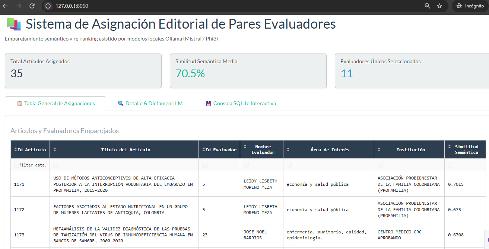
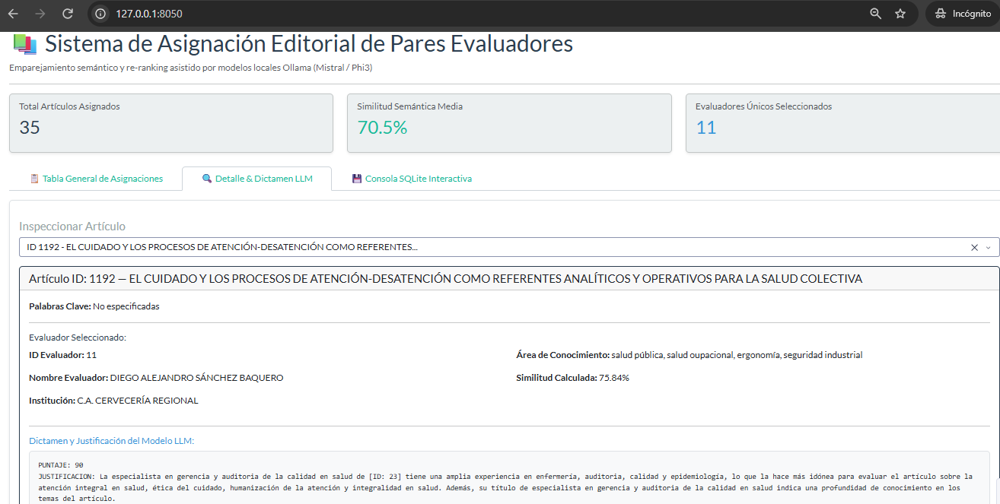
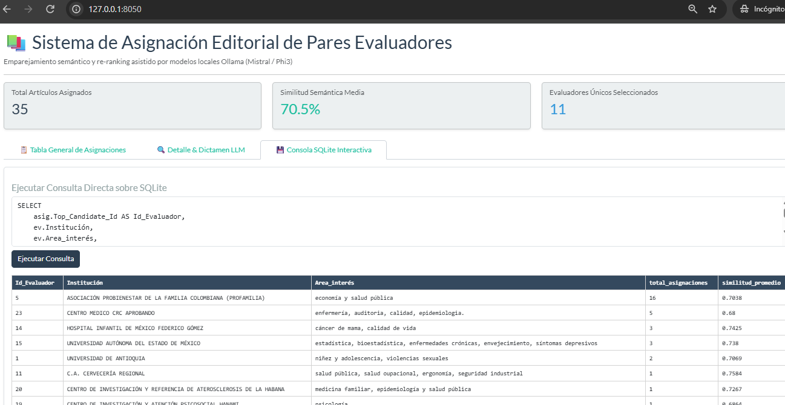

# Entrega_final_big_data
# Optimización de la Selección de Revisores por Pares

Aplicación interactiva desarrollada en **Dash** y **Python** para apoyar la asignación de pares evaluadores a artículos científicos mediante similitud semántica entre áreas de interés y temática del artículo, asistido por modelos locales de lenguaje (**Ollama**).

## 1. Caso de Uso

### Descripción General
El Comité Editorial de la revista enfrenta cuellos de botella y altos tiempos de espera en la fase inicial de asignación de pares evaluadores debido a la dispersión de la información y la revisión manual de perfiles. Este proyecto automatiza el cruce entre los manuscritos recibidos y la base de datos de evaluadores a partir de dos fuentes principales en Excel:
1. **Resúmenes de artículos (`data/summary.xlsx`):** textos no estructurados de títulos, palabras clave y resúmenes.
2. **Usuarios - Evaluadores (`data/evaluators.xlsx`):** caracterización académica e institucional de los evaluadores (incluyendo `Nombre_Evaluador`, área de interés e institución).

A partir de la afinidad temática y el análisis asistido por modelos locales en Ollama, el sistema genera puntajes de similitud, dictámenes/justificaciones y un ranking de candidatos para agilizar la toma de decisiones del comité editorial.

### Objetivo General
Diseñar una aplicación de recomendación y priorización de evaluadores basada en el área de interés y afinidad temática para reducir los tiempos de asignación y optimizar el flujo editorial.

### Objetivos Específicos
- Integrar, estandarizar y limpiar las fuentes de datos estructurados y textuales provenientes de los archivos de Excel de la revista.
- Calcular afinidad semántica y criterios de idoneidad entre manuscritos y evaluadores mediante procesamiento de lenguaje y modelos locales.
- Entregar una interfaz interactiva que permita consultar asignaciones, justificaciones del LLM y realizar consultas SQL directas.

## 2. Beneficios del Caso
- **Calidad de los datos:** permite detectar inconsistencias, valores faltantes y estandarizar información de artículos y evaluadores.
- **Reducción de tiempos editoriales:** disminuye los tiempos en la búsqueda inicial de pares evaluadores.
- **Fuentes integradas y depuradas:** consolida datos dispersos en una base de datos relacional (`SQLite`) lista para consulta.
- **Herramienta de apoyo a la decisión:** tablero interactivo para explorar métricas, el nombre y perfil del evaluador asignado, el dictamen del LLM y ejecutar consultas SQL.
- **Reutilización:** los datos consolidados pueden reutilizarse para análisis editoriales posteriores.

## Características principales

- **Emparejamiento semántico y dictamen LLM:** calcula embeddings de artículos y evaluadores y genera justificaciones/asignaciones mediante modelos locales ejecutados en Ollama.
- **Trazabilidad del evaluador (`Nombre Evaluador`):** integra la información de asignaciones de SQLite con los datos de evaluadores (incluyendo `Nombre_Evaluador` desde `data/evaluators.xlsx` cuando la tabla SQLite no incluye esa columna).
- **Tablero interactivo en Dash:**
  - **Tarjetas de métricas:** total de artículos asignados, similitud semántica media y evaluadores únicos seleccionados.
  - **Tabla General de Asignaciones:** visualización filtrable y ordenable con `IdArticulo`, `Titulo_Articulo`, `Id_Evaluador`, `Nombre_Evaluador`, `Area_Evaluador`, `Institucion_Evaluador` y `Similitud`.
  - **Detalle & Dictamen LLM:** inspección individual por artículo con metadatos, datos del evaluador seleccionado y justificación generada por el LLM.
  - **Consola SQLite Interactiva:** ejecución de consultas SQL directas sobre la base de datos de asignaciones.

## 3. Arquitectura Medallion
- **Capa Bronze:** archivos originales de entrada (`data/summary.xlsx` con títulos, palabras clave y resúmenes; `data/evaluators.xlsx` con la caracterización de evaluadores).
- **Capa Silver:** limpieza y estandarización de texto, construcción de descripciones enriquecidas, generación de embeddings con **`nomic-embed-text`** en Ollama y evaluación/re-ranking con **`mistral`** (`models/matcher_pipeline.py` / `matcher.py`).
- **Capa Gold:** Interfaz web (`models/app.py`): ver el tablero en `http://127.0.0.1:8050/`.

## Flujo de datos

1. **Fuentes de entrada (`data/`):**
   - `data/summary.xlsx`: artículos candidatos a evaluación (título, palabras clave, etc.).
   - `data/evaluators.xlsx`: perfil de evaluadores (`Id_Usuario`, `Nombre_Evaluador`, área de interés, institución, etc.).
2. **Pipeline de emparejamiento (`models/matcher_pipeline.py`):**
   - Genera embeddings con `nomic-embed-text` y evalúa coincidencias con `mistral` a través de Ollama, persistiendo los resultados en SQLite.
3. **Capa de consulta (`models/query.py`):**
   - Conecta a `editorial_assignments.db`, cruza `asignaciones`, `articulos` y `evaluadores`, y completa `Nombre_Evaluador` desde `data/evaluators.xlsx` cuando aplica.
4. **Interfaz web (`models/app.py`):**
   - Renderiza el tablero en `http://127.0.0.1:8050/`.

## Estructura del Proyecto

* `Entrega_final_big_data/`
  * `data/`
    * `summary.xlsx`
    * `evaluators.xlsx`
  * `img/`
    * `Imagen_1.png`
    * `Imagen_2.png`
    * `Imagen_3.png`
  * `models/`
    * `app.py`
    * `query.py`
    * `matcher_pipeline.py`
  * `src/`
  * `.python-version`
  * `README.md`
  * `asignaciones_finales.xlsx`
  * `editorial_assignments.db`
  * `pyproject.toml`
  * `requirements.txt`
  * `uv.lock`

# Requisitos previos
Python 3.13 y entorno virtual (.venv).

Ollama instalado y en ejecución en el equipo local, con los modelos descargados:

PowerShell
ollama pull nomic-embed-text
ollama pull mistral
Librerías de Python: dash, dash-bootstrap-components, pandas, scikit-learn, openpyxl, ollama.

## Instalación y ejecución
1. Activar el entorno virtual en Visual Studio Code
PowerShell
.venv\Scripts\Activate.ps1

2. Generar o actualizar la base de datos (opcional si ya cuentas con editorial_assignments.db)
PowerShell
python models\matcher_pipeline.py
Nota: el procesamiento con mistral en local puede tardar según el volumen de artículos y evaluadores. Si ya dispones de un archivo editorial_assignments.db válido, puedes ubicarlo en la ruta esperada por el proyecto e iniciar directamente la aplicación.

3. Iniciar la aplicación Dash
PowerShell
python models\app.py
Abre en el navegador la dirección:

Plaintext
[http://127.0.0.1:8050/](http://127.0.0.1:8050/)

### Vista general del tablero de asignación de evaluadores

### Pestaña de detalle y dictamen del modelo LLM

### Consola SQLite interactiva con consulta de asignaciones

